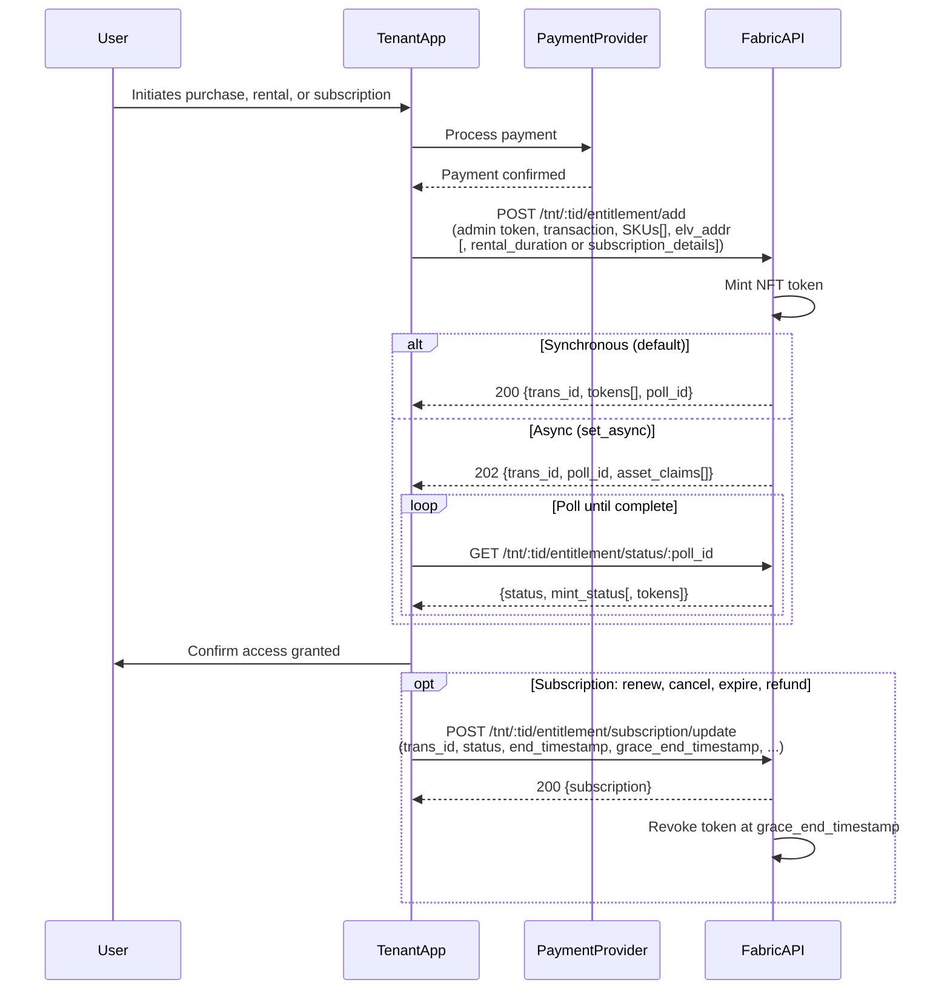

# Entitlements API

> **Deprecated:** this page has moved to [https://docs.eluv.io/docs/media-wallet/api-guide/purchase/entitlements/](https://docs.eluv.io/docs/media-wallet/api-guide/purchase/entitlements/) and is no longer maintained here.

Use this path to grant a user access to content by submitting a fulfilled purchase, rental, or subscription directly to
the Eluvio Authority. Supports purchase, rental, and subscription types, with fine-grained rental window control and
subscriptions you keep in step with your billing system.

---

## Overview

---

## Endpoints

| Operation               | Endpoint                                         |
|-------------------------|--------------------------------------------------|
| Create entitlement      | `POST /tnt/:tid/entitlement/add`                 |
| Poll entitlement status | `GET /tnt/:tid/entitlement/status/:poll_id`      |
| List entitlements       | `POST /tnt/:tid/entitlement/list/:addr`          |
| Revoke by token         | `POST /tnt/:tid/entitlement/revoke`              |
| Revoke by SKU           | `POST /tnt/:tid/entitlement/revoke_by_sku`       |
| Record watch start      | `POST /tnt/:tid/entitlement/rental/watch_start`  |
| Update subscription     | `POST /tnt/:tid/entitlement/subscription/update` |

Authentication: tenant admin bearer token for all operations.

---

## When to Use

- Payment is processed outside Eluvio (any provider)
- You need rental window control (`start_watch`, `active_for`)
- You sell subscriptions (SVOD) billed by your own system, and keep them current as they renew, cancel, or refund
- You want entitlement records for reporting and revocation
- You are integrating with a distributor or affiliate system

---

## Supported Transaction Types

| Type         | Description                                                            |
| ------------ | ---------------------------------------------------------------------- |
| purchase     | Permanent entitlement                                                  |
| rental       | Time-limited entitlement                                               |
| subscription | Entitlement for a paid period, renewed or ended through the update API |

---

## API Reference

- [Create Entitlement](./create.md) -- submit a purchase, rental, or subscription after payment confirmation;
  supports sync or async confirmation, see [poll status endpoint](./create.md#poll-entitlement-status)
  and [optimistic access to pending entitlements](./create.md#optimistic-access-to-media)
- [List Entitlements](./list.md) -- retrieve and verify a user's entitlements, with pagination and rental state filtering
- [Revoke Single Entitlement](./revoke.md) -- revoke a specific NFT token by contract address and token ID
- [Revoke Entitlement by SKU](./revoke-by-sku.md) -- revoke all tokens for one or more SKUs from a user's wallet
- [Rental Watch Start](./watch-start.md) -- record when a user first begins watching a rental, anchoring the active window
- [Rental Timing Model](./rental-timing.md) -- describes the Rental Duration and Playback Duration model for rentals
- [Update Subscription](./subscription-update.md) -- renew, cancel, expire, or refund a subscription, and set its
  grace period and metadata
